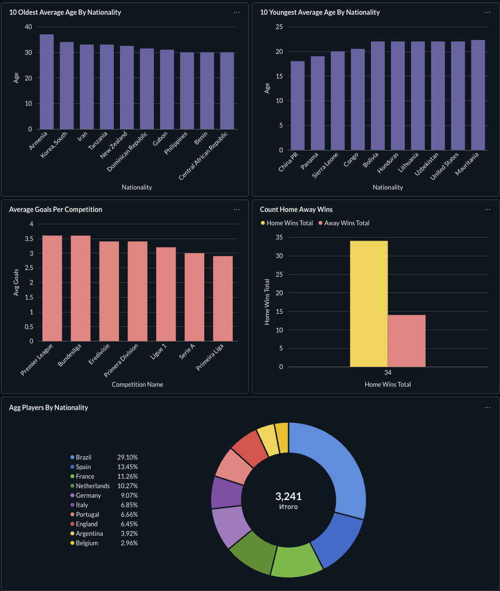
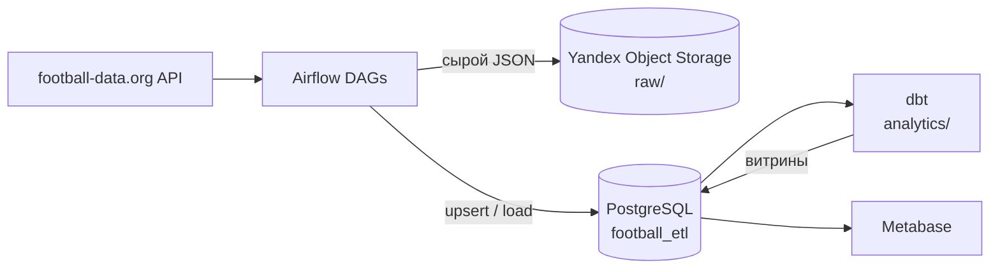

# ⚽ Football ETL

Сквозной data-проект на собственном сервере: ежедневная загрузка данных восьми европейских и бразильской футбольных лиг из API, хранение сырых ответов в объектном хранилище, нормализованное хранилище в PostgreSQL и аналитические витрины на dbt.


## О проекте

Проект собран как «маленькая промышленная» платформа данных, но целиком живёт на личном домашнем сервере, без облачных управляемых сервисов (кроме объектного хранилища для сырых данных). Цель: пройти путь данных целиком, от внешнего API до витрин, и сделать это воспроизводимо и с нормальной эксплуатацией: расписание, ретраи, лимиты API, идемпотентные загрузки, документация.

Что делает система:

1. **Airflow** ежедневно забирает из [football-data.org](https://www.football-data.org/) турниры, команды, игроков и завершённые матчи.
2. **Сырые ответы API** без изменений складываются в Yandex Object Storage (слой raw). Из них при необходимости можно пересобрать всё хранилище.
3. **Нормализованные записи** загружаются в PostgreSQL (база `football_etl`).
4. **dbt** приводит эти таблицы к единому виду в staging-слое (с тестами) и строит аналитические витрины: турнирные таблицы, домашнее преимущество, средние голы, статистика игроков..
5. **Metabase** подключается к PostgreSQL и показывает дашборд поверх витрин.

## Дашборд
 

 

## Архитектура



## Стек

| Слой | Технология |
| --- | --- |
| Оркестрация | Apache Airflow 2.10 (LocalExecutor) |
| Хранилище | PostgreSQL 16 |
| Сырые данные | Yandex Object Storage (S3-совместимое, `boto3`) |
| Трансформации | dbt (dbt-core + dbt-postgres): staging, marts, тесты |
| BI | Metabase |
| Инфраструктура | Docker Compose на собственном сервере |

## Где это работает

Весь стек запущен на личном домашнем сервере под Ubuntu Server (Intel Core i5-9400F, 16 ГБ RAM). Системный SSD отдан под ОС и Docker, отдельный HDD на 1 ТБ хранит данные PostgreSQL. Сервисы поднимаются одним `docker-compose.yaml`: Airflow, PostgreSQL и Metabase.

Особенности такого размещения:

- **Деплой через git.** Каталог `dags/` смонтирован в контейнер Airflow прямо из клона этого репозитория на сервере, поэтому обновление DAG-ов сводится к `git pull`.
- **Две базы в одном PostgreSQL.** Метаданные Airflow и данные проекта (`football_etl`) разнесены по разным базам одного экземпляра.
- **Секреты не в репозитории.** Ключи API и доступы к хранилищу лежат в Airflow Variables, учётные данные контейнеров в `.env` на сервере (в git он не попадает).
- **Удалённый доступ.** Сервер находится за домашним провайдером, поэтому внешний доступ к веб-интерфейсам и БД организован через SSH-туннели; разработка ведётся на ноутбуке, на сервер уходит `git push` → `git pull`.

## Структура репозитория

| Путь | Назначение |
| --- | --- |
| [`dags/`](dags/README.md) | Airflow DAG-и загрузки данных. |
| [`analytics/`](analytics/README.md) | dbt-проект с аналитическими моделями. |
| [`sample_data/`](sample_data/README.md) | Примеры ответов football-data.org для изучения и отладки. |
| [`sql/`](sql/README.md) | DDL исходных таблиц PostgreSQL. |
| `docker-compose.yaml` | Стек сервера: Airflow, PostgreSQL, Metabase. |

## Данные

Охвачены восемь соревнований:

| Код | Турнир |
| --- | --- |
| `pl` | Премьер-лига (Англия) |
| `bl` | Бундеслига (Германия) |
| `ded` | Эредивизи (Нидерланды) |
| `bsa` | Кампеонату Бразилейру Серия A (Бразилия) |
| `pd` | Примера (Испания) |
| `fl1` | Лига 1 (Франция) |
| `ppl` | Примейра-лига (Португалия) |
| `sa` | Серия A (Италия) |

Проект сознательно ограничен одним сезоном: история изменений составов и команд не отслеживается.

## Быстрый старт (на сервере)

1. Склонируйте репозиторий и создайте `.env` с учётными данными Airflow и PostgreSQL для `docker-compose.yaml`.
2. Запустите сервисы:

   ```bash
   docker compose up airflow-init
   docker compose up -d
   ```

3. Создайте базу `football_etl` и таблицы по инструкции в [`sql/`](sql/README.md).
4. В интерфейсе Airflow задайте Variables и создайте пул `football_api_pool` (список в [`dags/`](dags/README.md)).
5. Включите DAG-и `football_teams_dag` и `football_matches_dag`.
6. Настройте профиль dbt и запустите витрины (см. [`analytics/`](analytics/README.md)):

   ```bash
   cd analytics
   dbt debug
   dbt run
   dbt test
   ```

После изменения `docker-compose.yaml` стек применяется так, а контейнеры, которых больше нет в файле, удаляются:

```bash
docker compose up -d --remove-orphans
```

## Ключевые решения

| Решение | Почему |
| --- | --- |
| Два отдельных DAG-а: справочники и матчи | У данных разная динамика: составы меняются редко, матчи появляются каждый день. |
| Параллельная обработка лиг через dynamic task mapping | Лиги независимы; код один, число параллельных задач определяется списком лиг. |
| Пул Airflow для запросов к API | Бесплатный тариф API ограничивает частоту запросов; пул централизованно держит лимит. |
| Окно загрузки матчей: 7 дней до вчерашнего | API на бесплатном тарифе отдаёт данные с задержкой; берём только `FINISHED` и перекрываем интервал, чтобы не терять поздние обновления. |
| Upsert по `match_id` | Повторные запуски идемпотентны: счёт и судья обновляются, дублей нет. |
| Сырой JSON в объектном хранилище | Можно пересобрать любые таблицы без повторных обращений к API. |
| Секреты в Airflow Variables | Ключи не попадают в код и репозиторий. |
| Национальность игрока как обычный текст, без внешнего ключа | Усложнение схемы не окупается на текущем масштабе; возможное будущее расширение. |


