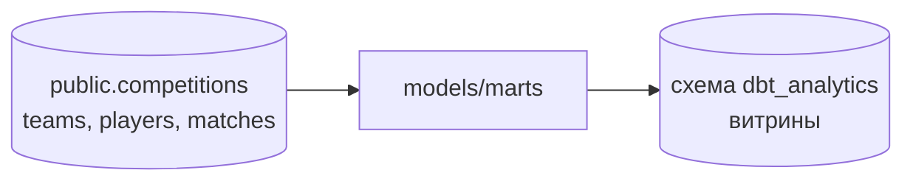

# Analytics (dbt)

dbt-проект для построения аналитических витрин поверх таблиц PostgreSQL. Имя проекта и профиля — `analytics`.

Данные загружаются Airflow в базу `football_etl` на личном сервере; dbt читает исходные таблицы и пишет результаты в отдельную схему той же базы, чтобы сырые таблицы и витрины не смешивались.



## Источники

В [`models/staging/sources.yaml`](models/staging/sources.yaml) определён источник `football_data` в схеме `public` со следующими таблицами:

- `competitions`;
- `teams`;
- `players`;
- `matches`.

Перед запуском dbt эти таблицы должны быть созданы DDL из [`../sql/sql_tables_schema.sql`](../sql/sql_tables_schema.sql) и наполнены Airflow DAG-ами.

## Модели

Модели размещены в `models/marts/` и формируют витрины по матчам, турнирам и игрокам:

| Модель | Назначение |
| --- | --- |
| `count_home_away_wins` | Подсчёт домашних и гостевых побед. |
| `average_goals_per_competition` | Среднее число голов в разрезе турниров. |
| `agg_players_by_nationality` | Количество игроков по национальностям. |
| `10_oldest_average_age_by_nationality` | Национальности с наиболее высоким средним возрастом игроков. |
| `10_youngest_average_age_by_nationality` | Национальности с наиболее низким средним возрастом игроков. |
| `tournaments_table` | Турнирная таблица по соревнованиям. |

Описание моделей и проверки ключевых полей находятся в `models/marts/schema.yml`.

## Установка

Нужен классический dbt на Python, а не новый единый `dbt` CLI: он пока не поддерживает PostgreSQL.

```bash
python3 -m venv .venv
source .venv/bin/activate
pip install dbt-postgres      # dbt-core подтянется как зависимость
dbt --version                 # должен показать dbt-core 1.x и адаптер postgres
```

## Профиль

Создайте профиль `analytics` в `~/.dbt/profiles.yml`:

```yaml
analytics:
  target: dev
  outputs:
    dev:
      type: postgres
      host: localhost
      port: 5432
      user: <пользователь>
      password: "{{ env_var('DBT_PG_PASSWORD') }}"
      dbname: football_etl
      schema: dbt_analytics
      threads: 4
```

Пароль берётся из переменной окружения и не хранится в файле. Схема `dbt_analytics` создаётся dbt автоматически при первом запуске.

### Откуда запускать

- **На сервере:** `host: localhost` работает сразу.
- **С ноутбука:** PostgreSQL на сервере не открыт наружу, поэтому подключаются через SSH-туннель и указывают в профиле локальный конец туннеля:

  ```bash
  ssh -N -L 15432:localhost:5432 <пользователь>@<сервер>
  ```

  В профиле при этом `host: localhost`, `port: 15432`.

## Запуск

Из этого каталога:

```bash
dbt debug    # проверка профиля и соединения
dbt run      # построение моделей
dbt test     # проверки из YAML-описаний
```

Одну модель можно пересобрать отдельно: `dbt run --select tournaments_table`.

## Развитие

- Добавить staging-слой (по одной модели на исходную таблицу: переименование колонок, приведение типов) и строить витрины поверх него.
- Запускать `dbt run` и `dbt test` из Airflow сразу после загрузки данных.
- Подключить Metabase к схеме `dbt_analytics` и собрать дашборды.
