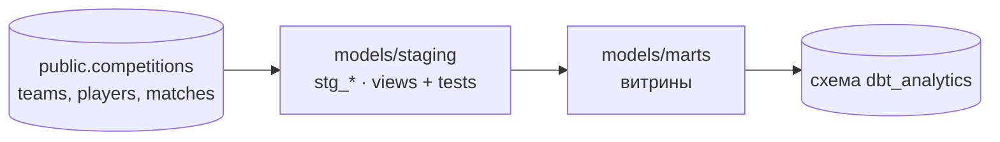

# Analytics (dbt)

dbt-проект для построения аналитических моделей поверх таблиц PostgreSQL. Имя проекта и профиля — `analytics`.

Данные загружаются Airflow в базу `football_etl` на личном сервере. dbt читает исходные таблицы, приводит их к единому виду в staging-слое и строит аналитические витрины. Результаты пишутся в отдельную схему той же базы, чтобы сырые таблицы и модели не смешивались.



## Слои

| Слой | Каталог | Что делает |
| --- | --- | --- |
| Источники | `models/staging/sources.yaml` | Описывает исходные таблицы Airflow. |
| Staging | `models/staging/` | Одна модель на исходную таблицу: отбор нужных колонок, отсев некорректных строк, простые вычисляемые поля. Материализация — `view`. |
| Marts | `models/marts/` | Аналитические витрины: агрегаты и турнирные таблицы. |

## Источники

В [`models/staging/sources.yaml`](models/staging/sources.yaml) определён источник `football_data` в схеме `public` со следующими таблицами:

- `competitions`;
- `teams`;
- `players`;
- `matches`.

Перед запуском dbt эти таблицы должны быть созданы DDL из [`../sql/sql_tables_schema.sql`](../sql/sql_tables_schema.sql) и наполнены Airflow DAG-ами.

## Staging-модели

| Модель | Источник | Что делает |
| --- | --- | --- |
| `stg_competitions` | `competitions` | Идентификатор и название турнира; отбрасывает строки без `competition_id`. |
| `stg_teams` | `teams` | Название, аббревиатура, стадион, адрес и турнир команды; отбрасывает строки без `team_id`. |
| `stg_players` | `players` | Данные игрока и вычисляемый возраст `age` (полных лет на текущую дату); оставляет только игроков с известной датой рождения. |
| `stg_matches` | `matches` | Команды, счёт и судья; флаги `home_wins` и `away_wins` (1/0, при ничьей оба 0); оставляет только матчи с известным счётом. |

Описание моделей и тесты находятся в `schema.yml`:

- `unique` и `not_null` на первичных ключах;
- `relationships` на внешних ключах: матчи ссылаются на турниры и команды, команды на турниры;
- `not_null` на счёте матча и `accepted_values` (0 и 1) на флагах побед.

## Витрины

Модели размещены в `models/marts/`:

| Модель | Назначение |
| --- | --- |
| `count_home_away_wins` | Подсчёт домашних и гостевых побед. |
| `average_goals_per_competition` | Среднее число голов за матч в разрезе турниров (топ-7). |
| `agg_players_by_nationality` | Количество игроков по национальностям. |
| `10_oldest_average_age_by_nationality` | Национальности с наиболее высоким средним возрастом игроков. |
| `10_youngest_average_age_by_nationality` | Национальности с наиболее низким средним возрастом игроков. |
| `tournaments_table` | Турнирная таблица по соревнованиям: игры, победы, ничьи, поражения, разница голов, очки. |

Витрины не обращаются к сырым таблицам: они читают только staging-модели через `ref('stg_...')`, поэтому вся очистка данных живёт в одном слое.

## Установка

Нужен классический dbt на Python, а не новый единый `dbt` CLI: он пока не поддерживает PostgreSQL.

```bash
python3 -m venv .venv
source .venv/bin/activate
pip install dbt-postgres      # dbt-core подтянется как зависимость
dbt --version                 # должен показать dbt-core 1.x и адаптер postgres
```

## Профиль

Создайте профиль `analytics` в `~/.dbt/profiles.yml`:

```yaml
analytics:
  target: dev
  outputs:
    dev:
      type: postgres
      host: localhost
      port: 5432
      user: <пользователь>
      password: "{{ env_var('DBT_PG_PASSWORD') }}"
      dbname: football_etl
      schema: dbt_analytics
      threads: 4
```

Пароль берётся из переменной окружения и не хранится в файле. Схема `dbt_analytics` создаётся dbt автоматически при первом запуске.

### Откуда запускать

- **На сервере:** `host: localhost` работает сразу.
- **С ноутбука:** PostgreSQL на сервере не открыт наружу, поэтому подключаются через SSH-туннель и указывают в профиле локальный конец туннеля:

  ```bash
  ssh -N -L 15432:localhost:5432 <пользователь>@<сервер>
  ```

  В профиле при этом `host: localhost`, `port: 15432`.

## Запуск

Из этого каталога:

```bash
dbt debug      # проверка профиля и соединения
dbt run        # построение всех моделей
dbt test       # проверки из YAML-описаний
dbt build      # run и test вместе, в порядке зависимостей
```

Отдельные слои и модели:

```bash
dbt build --select staging              # только staging: модели и их тесты
dbt run --select tournaments_table      # одна витрина
```