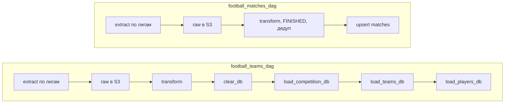

# Airflow DAG-и

Два ежедневных DAG-а загрузки данных. Оба запускаются по расписанию `@daily`, не догружают исторические интервалы (`catchup=False`) и обрабатывают восемь лиг: `pl`, `bl`, `ded`, `bsa`, `pd`, `fl1`, `ppl`, `sa`.

Airflow работает на личном сервере в составе Docker Compose-стека (LocalExecutor). Этот каталог смонтирован в контейнер Airflow прямо из клона репозитория на сервере, поэтому после `git pull` планировщик подхватывает изменения без копирования файлов.

## Обзор

| DAG | Файл | Назначение |
| --- | --- | --- |
| `football_teams_dag` | `football_teams_dag.py` | Загружает турниры, команды и игроков. |
| `football_matches_dag` | `football_matches_dag.py` | Загружает завершённые матчи за последние семь дней. |



## `football_teams_dag`

Для каждой лиги DAG получает состав участников и формирует три набора данных: турниры, команды и игроки. Необработанный ответ API сохраняется в объектное хранилище по пути `raw/teams/<league>.json`.

Справочники загружаются полной перезаписью. Перед загрузкой в PostgreSQL DAG очищает таблицы `players`, `teams` и `competitions`, затем заполняет их строго в порядке зависимостей внешних ключей:

```text
clear_db → load_competition_db → load_teams_db → load_players_db
```

Особенности:

- Игрок может числиться в двух командах (например, аренда), а `player_id` уникален. Перед вставкой дубликаты по `player_id` отбрасываются, остаётся первая запись.
- Национальность игрока хранится обычным текстом, без внешнего ключа.

## `football_matches_dag`

DAG получает матчи за интервал от семи дней назад до вчерашнего дня и оставляет только матчи со статусом `FINISHED`. Вчерашний день выбран намеренно: к этому моменту матчи уже завершены и данные в API стабилизировались.

Данные дедуплицируются по `match_id`. В PostgreSQL применяется upsert: при повторной загрузке обновляются счёт и информация о судье. Перекрывающееся окно в семь дней делает запуск идемпотентным и исправляет запоздавшие изменения в API.

Полный исходный ответ API сохраняется в объектное хранилище по пути `raw/matches/<league>/<date>.json`.

## Общие приёмы

- **Параллелизм по лигам.** Задачи извлечения создаются динамически (dynamic task mapping), по одной на лигу.
- **Лимит API.** Все задачи извлечения выполняются в пуле Airflow `football_api_pool`, поэтому число одновременных запросов не превышает лимит бесплатного тарифа.
- **Raw-слой.** Каждый ответ API сохраняется без изменений до трансформации; запись в S3 выполняется напрямую через `boto3`.
- **Очерёдность загрузки** в PostgreSQL задаётся явными зависимостями задач, а не порядком в файле.

## Требуемые Airflow Variables

Все секреты и адреса хранятся в Airflow Variables (Admin → Variables), а не в коде.

| Переменная | Назначение |
| --- | --- |
| `api_key` | Токен API football-data.org. |
| `<league>_teams` | URL API команд конкретной лиги. |
| `<league>_matches` | URL API матчей конкретной лиги. |
| `DB_CONNECTION` | Строка подключения SQLAlchemy к PostgreSQL (база `football_etl`). Хост — имя сервиса PostgreSQL в Docker-сети. |
| `YC_ACCESS_KEY` | Access key для Yandex Object Storage. |
| `YC_SEC_KEY` | Secret key для Yandex Object Storage. |
| `YC_BUCKET` | Имя бакета для исходных JSON. |

Пул `football_api_pool` нужно создать заранее (Admin → Pools). Размер пула подбирается под лимит запросов тарифа API.

## Запуск

1. Убедитесь, что таблицы созданы ([`../sql/`](../sql/README.md)), а Variables и пул заданы.
2. Включите DAG-и в интерфейсе Airflow.
3. Для первой загрузки запустите `football_teams_dag`, затем `football_matches_dag` вручную (Trigger DAG).

Дальше оба DAG-а работают по расписанию.
