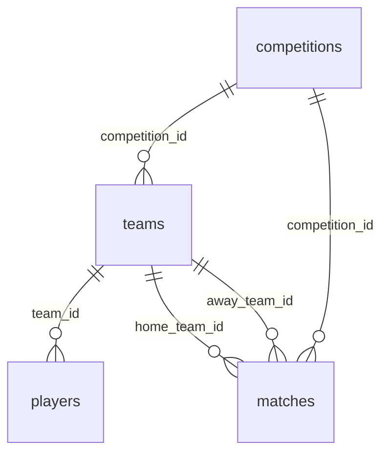

# PostgreSQL schema

Этот каталог документирует схему из [`sql_tables_schema.sql`](sql_tables_schema.sql). Файл создаёт исходные таблицы PostgreSQL, которые наполняются Airflow DAG-ами и используются dbt как источники.

Таблицы живут в отдельной базе `football_etl` внутри того же экземпляра PostgreSQL на сервере, где хранятся и метаданные Airflow. Базы разделены намеренно: служебные данные оркестратора не смешиваются с данными проекта.

## Таблицы

| Таблица | Первичный ключ | Назначение |
| --- | --- | --- |
| `competitions` | `competition_id` | Футбольные турниры. |
| `teams` | `team_id` | Команды и их принадлежность к турниру. |
| `players` | `player_id` | Игроки и их команда. |
| `matches` | `match_id` | Результаты матчей и информация о судье. |

## Связи

Связи определены внешними ключами: `teams.competition_id → competitions`, `players.team_id → teams`, а также `matches.competition_id`, `matches.home_team_id` и `matches.away_team_id` ссылаются на соответствующие турниры и команды.



Из-за внешних ключей порядок загрузки фиксирован: `competitions → teams → players`. Именно так построена цепочка задач в [`football_teams_dag`](../dags/README.md).

## Проектные решения

- **Национальность игрока** хранится обычным текстом, без внешнего ключа на сборные: связь усложнила бы схему без заметной пользы на текущем масштабе. Можно вернуть позже.
- **Дубликаты игроков** (аренда: один `player_id` в составах двух клубов) отсекаются на этапе загрузки, остаётся первая запись.
- **Матчи** хранятся по `match_id` и обновляются upsert-ом, поэтому повторная загрузка того же интервала безопасна.
- **Один сезон.** История изменений не ведётся: схема описывает текущее состояние.

## Применение

Выполните DDL в целевой базе PostgreSQL до первого запуска DAG-ов. Если базы ещё нет, создайте её, затем примените схему (имена сервиса и пользователя подставьте свои из `docker-compose.yaml`):

```bash
docker compose exec <сервис-postgres> psql -U <пользователь> -c "CREATE DATABASE football_etl;"
docker compose exec -T <сервис-postgres> psql -U <пользователь> -d football_etl < sql/sql_tables_schema.sql
```

Скрипт использует `CREATE TABLE IF NOT EXISTS`, поэтому его можно запускать повторно. Этот README намеренно относится только к `sql_tables_schema.sql`.
